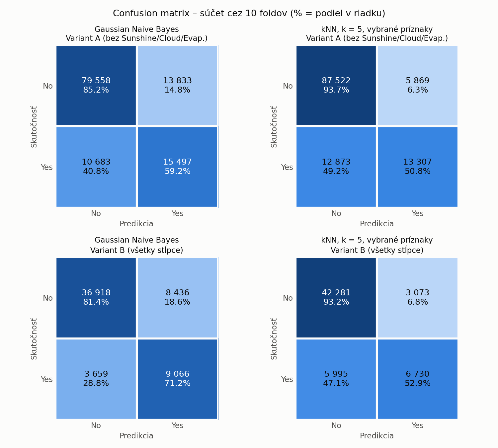
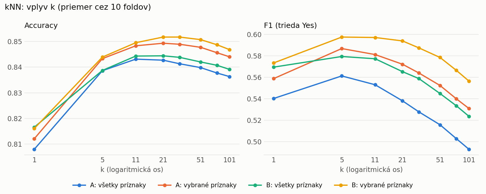

# Predpoveď dažďa – weatherAUS

Klasifikácia `RainTomorrow` (bude zajtra pršať?) pomocou Gaussovho naivného Bayesa a kNN
na datasete [weatherAUS](https://www.kaggle.com/jsphyg/weather-dataset-rattle-package).

## Spustenie

```bash
pip install pandas numpy scikit-learn matplotlib
python src/preprocessing.py   # kontrola predspracovania
python src/evaluate.py        # 10-fold CV, výsledky do results/*.csv
python src/plots.py           # grafy do results/*.png
```

## Predspracovanie dát

- **Odstránenie `RISK_MM`**: je to množstvo zrážok na nasledujúci deň, teda by modelu prezradilo odpoveď.
- **`RainTomorrow` ako cieľ `y`**: oddelené od príznakov, Yes = 1, No = 0.
- **Lokalita → zemepisná šírka a dĺžka**: názov mesta nemá číselný význam, súradnice áno.
- **Smer vetra → sin a cos uhla**: samotný uhol by robil zo smerov N (0°) a NNW (337,5°) vzdialené hodnoty, hoci sú susedné.
- **Bezvetrie**: pri rýchlosti vetra 0 smer chýba, lebo neexistuje. Tieto riadky nezahadzujeme, smer nastavíme na sin = cos = 0.
- **Dátum → mesiac ako sin a cos**: ročné obdobie ovplyvňuje dážď a december s januárom zostanú vedľa seba.
- **`RainToday` → 0/1**.
- **`log(1 + x)` pre zrážky a odpar**: väčšina dní má 0 mm, logaritmus zmierni zošikmenie (pomáha Gaussovmu NB).
- **Odstránenie riadkov s chýbajúcimi hodnotami**: klasifikátory s nimi nevedia pracovať.

### Dva varianty dát

Stĺpce `Sunshine`, `Evaporation`, `Cloud9am` a `Cloud3pm` chýbajú v 38–48 % riadkov, ale patria
medzi najsilnejšie prediktory. Preto porovnávame dva varianty:

| Variant | Riadky | Príznaky |
|---|---|---|
| A – bez týchto stĺpcov | 119 571 | 23 |
| B – so všetkými stĺpcami | 58 079 | 27 |

V oboch je dážď nasledujúci deň v 21,9 % prípadov, rovnako ako v pôvodných dátach.

### Normalizácia

Normalizácia na rozsah 0–1 sa robí až počas cross-validácie, iba z trénovacích dát.
Inak by informácia z testovacích dát unikla do trénovania.

## Vyhodnotenie (`evaluate.py`)

- **10-fold stratifikovaná cross-validácia** (`StratifiedKFold`): dáta sa rozdelia na 10 častí,
  každá má rovnaký podiel dažďa (~22 %). Každá časť je raz testovacia, zvyšných 9 slúži na trénovanie.
- **Gaussian Naive Bayes** používa všetky príznaky.
- **kNN** sa skúša pre k = 1, 5, 11, 21, 31, 51, 75, 101 a s dvoma sadami príznakov:
  - *všetky príznaky*,
  - *vybrané príznaky*: kNN váži každý stĺpec rovnako, preto vynechávame duplicitné
    (4 teploty → `Temp3pm`, 2 tlaky → `Pressure3pm`, 3 smery vetra → nárazový).
    Ostáva `Humidity3pm`, `Pressure3pm`, `Temp3pm`, `Rainfall`, `RainToday`, `WindGustSpeed`,
    smer nárazu, poloha a mesiac, vo variante B navyše `Sunshine` a `Cloud3pm`.
- **Baseline** vždy predpovedá „nebude pršať“. Slúži na porovnanie, lebo triedy sú nevyvážené.
- **Metriky**: accuracy, balanced accuracy, a pre triedu „dážď“ precision, recall a F1.
  Accuracy sama nestačí, keďže baseline má bez akéhokoľvek učenia 78 %.
- **Confusion matrix** sa sčíta cez všetkých 10 foldov.

Výstupy: `results/metrics.csv` (priemer ± smerodajná odchýlka cez foldy)
a `results/confusion_matrices.csv`.

## Výsledky

Priemer cez 10 foldov:

| Variant | Model | Accuracy | Precision | Recall | F1 |
|---|---|---|---|---|---|
| A | baseline (vždy No) | 0,781 | – | 0,000 | 0,000 |
| A | Gaussian NB | 0,795 | 0,528 | 0,592 | 0,558 |
| A | kNN k=5, všetky príznaky | 0,839 | 0,693 | 0,471 | 0,561 |
| A | kNN k=5, vybrané príznaky | 0,843 | 0,694 | 0,508 | 0,587 |
| B | baseline (vždy No) | 0,781 | – | 0,000 | 0,000 |
| B | Gaussian NB | 0,792 | 0,518 | 0,713 | 0,600 |
| B | kNN k=5, všetky príznaky | 0,839 | 0,676 | 0,507 | 0,579 |
| B | kNN k=5, vybrané príznaky | 0,844 | 0,687 | 0,529 | 0,598 |

Smerodajná odchýlka medzi foldami je pri všetkých metrikách do 0,02, výsledky sú teda stabilné.

### Confusion matrix



### Vplyv k na kNN



## Zhrnutie

- **kNN** má najvyššiu accuracy (~85 %), ale je opatrný: zachytí len asi polovicu daždivých dní.
  Keď predpovie dážď, má pravdu v ~70 % prípadov.
- **Gaussian NB** má nižšiu accuracy (~79 %), ale zachytí viac daždivých dní (recall až 71 %
  vo variante B). Platí za to viac falošných poplachov.
- **Výber príznakov pomáha kNN** vo všetkých prípadoch. Duplicitné stĺpce mu skresľujú vzdialenosti.
- **Hodnota k**: k = 1 je zašumené, najlepšie F1 je pri k = 5, najlepšia accuracy pri k = 21–31.
  Väčšie k posúva model k predpovedi „nebude pršať“, takže recall klesá.
- **Variant B** (so `Sunshine` a `Cloud`) dáva lepšie výsledky napriek polovičnému počtu riadkov,
  najviac pre Gaussian NB. Tieto stĺpce nesú viac informácie než chýbajúce riadky.

## Štruktúra

```
├── data/weatherAUS.csv
├── src/
│   ├── preprocessing.py
│   ├── evaluate.py
│   └── plots.py
├── results/
└── README.md
```